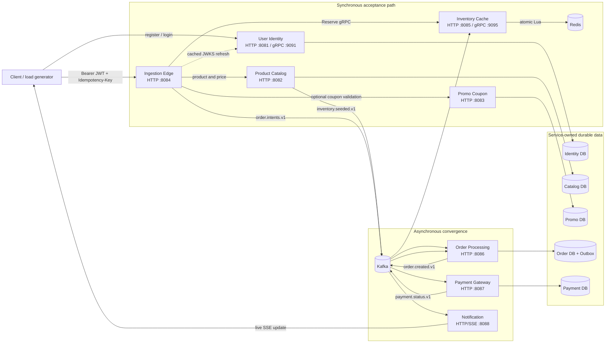

# saleStop

### A distributed flash-sale engine designed to absorb burst traffic without overselling inventory

[](https://github.com/gathik-jindal/ticketStop/actions/workflows/ci.yml)
[](https://github.com/gathik-jindal/ticketStop/actions/workflows/codeql.yml)
[](https://openjdk.org/projects/jdk/21/)
[](https://spring.io/projects/spring-boot)
[](LICENSE)

saleStop is an eight-service Spring Boot system that models the backend of a high-demand product drop. Its central problem is deceptively difficult: thousands of buyers may try to claim the final units at the same time, clients may retry requests, and the order database may be slower than the incoming traffic.

The solution separates **fast inventory reservation** from **durable order processing**. The synchronous path validates the caller, rate-limits traffic, and atomically reserves Redis inventory. Kafka then buffers accepted orders while PostgreSQL, payment, and notification services converge in the background.

> **Performance statement:** the architecture and k6 suite target a 20,000 requests/second cluster deployment with checkout p99 at or below 50 ms. This is a design target, not a claimed benchmark result. A valid result requires running the included workload on a documented, appropriately sized cluster.

## Table of contents

- [What the project demonstrates](#what-the-project-demonstrates)
- [Architecture](#architecture)
- [How checkout works](#how-checkout-works)
- [Services and data ownership](#services-and-data-ownership)
- [Quick start with Docker Compose](#quick-start-with-docker-compose)
- [Run a checkout manually](#run-a-checkout-manually)
- [Local JVM development](#local-jvm-development)
- [Configuration](#configuration)
- [Testing](#testing)
- [Observability](#observability)
- [Kubernetes deployment](#kubernetes-deployment)
- [Failure handling and consistency](#failure-handling-and-consistency)
- [Troubleshooting](#troubleshooting)
- [Repository layout](#repository-layout)

## What the project demonstrates

- **Concurrency correctness:** Redis Lua evaluates stock, idempotency, and buyer guards as one atomic operation.
- **Retry safety:** the same `Idempotency-Key` returns the original order instead of deducting inventory twice.
- **Hot-path authentication:** the edge verifies RS256 JWTs locally from a cached JWKS instead of calling identity for every checkout.
- **Mixed communication styles:** HTTP handles public APIs, gRPC handles the latency-sensitive inventory reservation, and Kafka handles background work.
- **Reliable event publication:** order processing uses a transactional outbox to avoid the database/Kafka dual-write problem.
- **At-least-once processing:** consumers assume events can repeat and use stable IDs and unique constraints to remain idempotent.
- **Operational readiness:** every service has health and Prometheus endpoints, a non-root container, CI checks, and Kubernetes resource/probe configuration.
- **Elastic scaling:** HPA scales edge and inventory pods by CPU while KEDA scales order workers from Kafka consumer lag.

## Architecture



The repository also contains the original [architecture diagram](docs/architecture.png) and a more detailed [architecture and consistency discussion](docs/ARCHITECTURE.md).

### Communication map

| From | To | Protocol | Why |
| --- | --- | --- | --- |
| Client | Identity, Catalog, Edge, Orders, Notifications | HTTP/JSON | Public and query APIs |
| Edge | Identity JWKS | HTTP, cached | Key refresh only; never a per-checkout authentication call |
| Edge | Inventory | gRPC/protobuf | Small typed payload on the critical reservation path |
| Edge | Catalog and Promo | HTTP/JSON | Product activity, price, and optional discount validation |
| Catalog and Edge | Kafka | Events | Inventory seeding and accepted order intents |
| Order, Payment, Notification | Kafka | Events | Decoupled background state transitions |
| Inventory and Edge | Redis | Lua / Redis operations | Atomic reservation and distributed token bucket |
| Identity, Catalog, Promo, Order, Payment | PostgreSQL | JDBC/JPA | Independently owned durable state |

## How checkout works

### Synchronous acceptance path

1. A client sends `POST /api/v1/checkout` with an access token and `Idempotency-Key`.
2. The edge consumes one token from a Redis token bucket keyed by client IP. Empty buckets receive `429 Too Many Requests` before touching core logic.
3. The edge parses the JWT `kid`, uses its local public-key cache, and verifies signature, issuer, audience, and expiry without network I/O. It refreshes JWKS only after TTL expiry or an unknown `kid`.
4. Catalog confirms the product is active and supplies its price. Promo validates an optional coupon.
5. The edge calls inventory over gRPC. A Redis Lua script atomically:
   - returns the original order for an idempotent retry;
   - rejects a user who already reserved the product;
   - rejects insufficient stock; or
   - decrements stock and records the reservation.
6. The edge publishes `order.intents.v1` with Kafka `acks=all` and idempotent producer settings.
7. Only after Kafka acknowledges the event does the edge return `202 Accepted`.

If Kafka publication fails, the edge calls inventory's compare-and-release operation to restore the reservation and returns `503 Service Unavailable`.

### Asynchronous convergence

1. Order Processing consumes the intent, ignores duplicates, and commits both the order and an outbox record in one PostgreSQL transaction.
2. The outbox publisher sends `order.created.v1` and marks the row published.
3. Payment consumes the event, runs the included deterministic demo provider, stores `SUCCEEDED`, and publishes `payment.status.v1`.
4. Order Processing consumes the payment event and advances the durable order from `PENDING_PAYMENT` to `PAID`.
5. Notification consumes the same event, retains the user's latest notifications, and pushes it to connected browsers over server-sent events.

This means `202 Accepted` represents a reserved and durably queued checkout—not an already completed payment. Clients obtain the final state from the order API or notification stream.

## Services and data ownership

| Service | Ports | State owned | Main responsibility |
| --- | --- | --- | --- |
| `user-identity` | 8081 / 9091 | Users and hashed refresh sessions | Registration, BCrypt passwords, refresh rotation, RS256 access tokens, JWKS |
| `product-catalog` | 8082 | Products and initial stock | Public product queries, admin product management, inventory seed events |
| `promo-coupon` | 8083 | Coupon rules | Activation-window, minimum-total, and percentage-discount validation |
| `ingestion-edge` | 8084 | None; stateless | Rate limiting, local JWT verification, checkout orchestration, intent publication |
| `inventory-cache` | 8085 / 9095 | Live Redis inventory keys | Atomic reservation, idempotency, buyer guard, availability, compensation |
| `order-processing` | 8086 | Orders and transactional outbox | Idempotent Kafka processing, durable ledger, DLQ, payment-state updates |
| `payment-gateway` | 8087 | Payment state and provider references | Demo provider adapter, webhook transitions, payment events |
| `notification` | 8088 | Latest 50 notifications per user in memory | Payment-event fan-out and live SSE delivery |

No service reads another service's database during normal operation. Relational services own separate databases and Flyway migrations. Shared event records and protobuf contracts live in `pkg/common`.

### Kafka topics

| Topic | Producer | Consumers | Meaning |
| --- | --- | --- | --- |
| `inventory.seeded.v1` | Product Catalog | Inventory Cache | Load an exact product allocation into Redis |
| `order.intents.v1` | Ingestion Edge | Order Processing | A reserved checkout that must become a durable order |
| `order.created.v1` | Order outbox publisher | Payment Gateway | A committed order awaiting payment |
| `payment.status.v1` | Payment Gateway | Order Processing, Notification | Final payment transition |
| `order.intents.dlq.v1` | Order error handler | Operators | Intent payloads exhausted after retry |

## Quick start with Docker Compose

This is the recommended way to run the complete system.

### 1. Prerequisites

- Git
- Docker Desktop or Docker Engine with Compose v2
- At least 6 GB of memory available to Docker is recommended for Kafka, PostgreSQL, Redis, and eight JVM services
- PowerShell 5.1+ or PowerShell 7 for the automated smoke test

Verify the tools:

```text
git --version
docker --version
docker compose version
```

Java and Maven are not required for the container-only path because the multi-stage Docker build compiles each service.

### 2. Clone and configure

```bash
git clone <repository-url>
cd saleStop
cp .env.example .env
```

PowerShell equivalent:

```powershell
git clone <repository-url>
Set-Location saleStop
Copy-Item .env.example .env
```

The example file contains local-only credentials. You may use them unchanged for a local demo; do not use them in a shared or production environment.

### 3. Build and start the stack

```bash
docker compose up --build -d
docker compose ps
```

The first build downloads Maven dependencies and container images, so it can take several minutes. Wait until PostgreSQL, Redis, and Kafka report healthy and the application services are running.

Useful progress commands:

```bash
docker compose ps
docker compose logs -f ingestion-edge inventory-cache order-processing
```

### 4. Run the end-to-end smoke test

```powershell
./scripts/smoke-test.ps1
```

The test performs the full business flow:

```text
register user → create product → wait for Redis seed → checkout
→ persist order → process payment → confirm order reaches PAID
```

A successful run ends with:

```text
Smoke test passed for order <uuid>
```

### 5. Inspect the system

| URL | Expected use |
| --- | --- |
| `http://localhost:8081/actuator/health` | Identity health |
| `http://localhost:8082/api/v1/products` | Product list |
| `http://localhost:8084/actuator/health` | Edge health |
| `http://localhost:8085/api/v1/inventory/{productId}` | Live cached stock |
| `http://localhost:8086/api/v1/orders/{orderId}` | Durable order state |
| `http://localhost:8088/api/v1/notifications?userId={uuid}` | Recent notification state |

### 6. Stop or reset

Stop containers while preserving data:

```bash
docker compose down
```

Delete containers **and** the local PostgreSQL/Redis volumes for a clean start:

```bash
docker compose down -v
```

Use `-v` intentionally: the PostgreSQL database creation script only runs when its data volume is first initialized.

## Run a checkout manually

The smoke test is the fastest demonstration. The following Bash example shows the underlying API calls and requires `curl` and `jq`.

### Register a user

```bash
AUTH=$(curl -sS -X POST http://localhost:8081/api/v1/auth/register \
  -H 'Content-Type: application/json' \
  -d '{"email":"ada@example.com","password":"correct-horse-battery-staple","fullName":"Ada Lovelace"}')

TOKEN=$(echo "$AUTH" | jq -r '.accessToken')
USER_ID=$(echo "$AUTH" | jq -r '.user.id')
```

### Create and seed a flash-sale product

```bash
PRODUCT=$(curl -sS -X POST http://localhost:8082/api/v1/products \
  -H 'X-Admin-Key: local-admin-key' \
  -H 'Content-Type: application/json' \
  -d '{"title":"Limited Mechanical Keyboard","price":129.99,"initialStock":100}')

PRODUCT_ID=$(echo "$PRODUCT" | jq -r '.id')

until curl -sf "http://localhost:8085/api/v1/inventory/$PRODUCT_ID" > /dev/null; do
  sleep 1
done
```

Creating the catalog product publishes `inventory.seeded.v1`; inventory consumes it and initializes the Redis stock key.

### Submit checkout

```bash
CHECKOUT=$(curl -sS -X POST http://localhost:8084/api/v1/checkout \
  -H "Authorization: Bearer $TOKEN" \
  -H "Idempotency-Key: demo-$(date +%s)" \
  -H 'Content-Type: application/json' \
  -d "{\"productId\":$PRODUCT_ID,\"quantity\":1}")

echo "$CHECKOUT" | jq
ORDER_ID=$(echo "$CHECKOUT" | jq -r '.orderId')
```

The expected response is HTTP `202` with `status: "ACCEPTED"`. Wait briefly for asynchronous processing, then query the order:

```bash
sleep 3
curl -sS "http://localhost:8086/api/v1/orders/$ORDER_ID" | jq
curl -sS "http://localhost:8088/api/v1/notifications?userId=$USER_ID" | jq
```

### Checkout status codes

| Status | Meaning |
| --- | --- |
| `202` | Newly accepted or a retry of an already accepted idempotency key |
| `400` | Invalid product, quantity, coupon, or request headers |
| `401` | Missing, expired, or invalid access token |
| `409` | Sold out or this user already reserved the product |
| `429` | The client IP exhausted its token bucket |
| `503` | Redis, inventory, catalog/promo, or durable Kafka publication is unavailable |

The full endpoint list is in [docs/API.md](docs/API.md).

## Local JVM development

Use this mode when editing or debugging Java code from an IDE.

### Prerequisites

- Java 21
- Maven 3.9+
- Docker Compose for PostgreSQL, Redis, and Kafka

```text
java -version
mvn -version
docker compose version
```

### Start infrastructure only

```bash
docker compose up -d postgres redis kafka
```

### Build shared contracts and all modules

```bash
mvn install -DskipTests
```

### Start services

Run each command in a separate terminal from the repository root:

```bash
mvn -pl services/user-identity spring-boot:run
mvn -pl services/product-catalog spring-boot:run
mvn -pl services/promo-coupon spring-boot:run
mvn -pl services/inventory-cache spring-boot:run
mvn -pl services/ingestion-edge spring-boot:run
mvn -pl services/order-processing spring-boot:run
mvn -pl services/payment-gateway spring-boot:run
mvn -pl services/notification spring-boot:run
```

Relational services use isolated PostgreSQL-compatible in-memory H2 databases by default in JVM development. Redis and Kafka use `localhost:6379` and `localhost:9092`. Restarting an H2-backed service clears its local relational data.

To develop against the Compose PostgreSQL databases instead, set that service's datasource URL, username, password, and driver using the values shown in `compose.yml`.

## Configuration

Copy `.env.example` to `.env` for Compose overrides. Spring configuration uses environment variables, so the same images work locally and in Kubernetes.

### Shared settings

| Variable | Local default | Purpose |
| --- | --- | --- |
| `KAFKA_BOOTSTRAP_SERVERS` | `localhost:9092` | Kafka broker list |
| `REDIS_HOST` / `REDIS_PORT` | `localhost` / `6379` | Redis connection |
| `SALESTOP_ADMIN_KEY` | `local-admin-key` | Protects catalog and coupon admin operations |
| `SALESTOP_INTERNAL_KEY` | `local-internal-key` | Authenticates edge-to-inventory internal operations |
| `PAYMENT_WEBHOOK_SECRET` | `local-webhook-secret` | Validates demo provider webhooks |

### Edge and identity settings

| Variable | Purpose |
| --- | --- |
| `JWKS_URI` | Identity JWKS endpoint cached by the edge |
| `JWT_ISSUER` / `JWT_AUDIENCE` | Claims the edge must accept |
| `RATE_LIMIT_CAPACITY` / `RATE_LIMIT_REFILL` | Redis token bucket behavior |
| `INVENTORY_GRPC_HOST` / `INVENTORY_GRPC_PORT` | Inventory reservation endpoint |
| `IDENTITY_JWT_PRIVATE_KEY_PATH` | PKCS#8 RSA private-key PEM mounted in identity |
| `IDENTITY_JWT_PUBLIC_KEY_PATH` | X.509 RSA public-key PEM mounted in identity |
| `IDENTITY_JWT_KEY_ID` | Optional stable `kid` used during key rotation |

When PEM paths are absent, identity generates a development key at startup. Tokens issued before an identity restart then become invalid. Production and multi-replica deployments must mount the same managed signing key into every identity pod.

### Database settings

Each relational service has its own prefix:

```text
IDENTITY_DATASOURCE_URL / USERNAME / PASSWORD / DRIVER
CATALOG_DATASOURCE_URL  / USERNAME / PASSWORD / DRIVER
PROMO_DATASOURCE_URL    / USERNAME / PASSWORD / DRIVER
ORDER_DATASOURCE_URL    / USERNAME / PASSWORD / DRIVER
PAYMENT_DATASOURCE_URL  / USERNAME / PASSWORD / DRIVER
```

Flyway migrations under `services/<service>/src/main/resources/db/migration` are the schema source of truth.

## Testing

### Full verification

```bash
mvn verify
```

This compiles protobuf contracts, formats/checks Java with Spotless, runs tests, validates Flyway-backed identity behavior, and packages every application as an executable Spring Boot JAR.

The test suite covers:

- registration, duplicate registration, login, authenticated identity lookup, and refresh rotation;
- coupon eligibility and price calculation;
- duplicate order-intent suppression and outbox creation;
- durable order payment-state transitions;
- payment event publication and notification fan-out;
- concurrent Redis reservation correctness through Testcontainers.

The Redis concurrency test starts a real Redis container and proves two simultaneous buyers cannot reserve a single unit. It skips when Docker is unavailable and runs normally in Docker-enabled CI.

### End-to-end test

```powershell
docker compose up --build -d
./scripts/smoke-test.ps1
```

### Load test

Install [k6](https://grafana.com/docs/k6/latest/set-up/install-k6/), start and seed the stack, then provide a real access token and product ID:

```bash
ACCESS_TOKEN='<token>' PRODUCT_ID=1 RATE=100 k6 run tests/load/checkout.js
```

The safe local defaults ramp to 100 arrivals/second. The documented target-cluster invocation, pass criteria, and consistency checks are in [docs/LOAD_TESTING.md](docs/LOAD_TESTING.md). Do not aim 20,000 requests/second at a laptop Compose environment.

## Observability

Every service exposes Spring Boot Actuator health and Prometheus metrics. Start the optional monitoring profile after the main stack:

```bash
docker compose --profile observability up -d prometheus grafana
```

| Component | URL | Local credentials |
| --- | --- | --- |
| Prometheus | `http://localhost:9090` | None |
| Grafana | `http://localhost:3000` | `admin` / `salestop` |
| Service metrics | `http://localhost:<service-port>/actuator/prometheus` | None locally |

Useful signals during a sale include edge request latency/status, Redis command latency, remaining inventory, Kafka consumer lag, outbox backlog, JVM pauses, database pool saturation, and DLQ growth.

## Kubernetes deployment

The Helm chart under `infra/helm/salestop` renders all eight Deployments and Services, shared configuration/secrets, probes, resource limits, HPA, KEDA, and optional ingress.

Prerequisites:

- Kubernetes cluster
- Helm 3
- KEDA installed for Kafka-lag scaling
- Reachable PostgreSQL, Redis, and Kafka endpoints
- Eight published service images in a container registry

Validate the chart:

```bash
helm lint infra/helm/salestop
helm template salestop infra/helm/salestop \
  --set imageRegistry=ghcr.io/your-user \
  --set secrets.postgresPassword=replace-me
```

Create a private values file for real endpoints and secrets, then install:

```bash
helm upgrade --install salestop infra/helm/salestop \
  --namespace salestop \
  --create-namespace \
  --values values.production.yaml
```

Do not commit `values.production.yaml`. Production deployments should use an external secret manager, TLS/mTLS, managed PostgreSQL/Redis/Kafka, persistent identity signing keys, centralized logs, and a real payment provider adapter.

## Failure handling and consistency

| Failure or race | Behavior |
| --- | --- |
| Two buyers request the final unit | Redis serializes the Lua script; one reserves and one receives sold out |
| Client retries after a timeout | The five-minute idempotency record returns the original order ID |
| Same user submits a new key | The product/user buyer guard rejects a second reservation |
| Kafka rejects the edge publish | Edge compare-and-releases inventory and returns `503` |
| Order event is delivered twice | Order ID and idempotency-key checks suppress the duplicate |
| Order DB commits but process stops before publish | The committed outbox row remains available for the next publisher cycle |
| Poison order event repeatedly fails | It is sent to `order.intents.dlq.v1` after retry exhaustion |
| Payment event is delivered twice | Payment/order state transitions remain stable by order ID |
| Identity key rotates | Edge refreshes JWKS on TTL expiry or an unknown `kid` |

Kafka delivery is at least once. The project does not claim distributed exactly-once behavior across Redis, Kafka, and PostgreSQL. The remaining process-crash window between Redis reservation and Kafka acknowledgement is explicit and should be monitored/reconciled in a production deployment.

## Troubleshooting

### A service is unhealthy or checkout returns `503`

```bash
docker compose ps
docker compose logs --tail=200 kafka redis postgres
docker compose logs --tail=200 ingestion-edge inventory-cache order-processing
```

Confirm Kafka, Redis, and PostgreSQL are healthy before debugging application services.

### Inventory returns `404 Inventory not seeded`

Create the product through Product Catalog with `X-Admin-Key`, then inspect catalog and inventory logs. Product creation publishes an asynchronous seed event, so allow a short convergence delay.

### Tokens become invalid after restarting identity

This is expected with the generated development RSA key. Register/login again, or configure persistent PEM files through the identity key-path variables.

### PostgreSQL says a service database does not exist

The initialization SQL runs only for a new Postgres volume. For disposable local data, run `docker compose down -v` and restart. For data you need to preserve, create the missing databases manually instead.

### Port already in use

The stack publishes ports 5432, 6379, 8081–8088, 9091, 9092, and 9095. Stop the conflicting process or change the relevant Compose host-side port.

### Redis concurrency test is skipped

Testcontainers could not find a working Docker daemon. Start Docker and rerun `mvn -pl services/inventory-cache -am test`.

### Start from a completely clean application build

```bash
mvn clean verify
docker compose build --no-cache
```

## Repository layout

```text
saleStop/
├── services/
│   ├── user-identity/       authentication, JWT, JWKS, refresh sessions
│   ├── product-catalog/     products and inventory seed publication
│   ├── promo-coupon/        coupon eligibility and pricing
│   ├── ingestion-edge/      authenticated checkout hot path
│   ├── inventory-cache/     Redis Lua and gRPC inventory reservation
│   ├── order-processing/    order ledger, consumers, outbox, DLQ
│   ├── payment-gateway/     demo payment state machine and webhooks
│   └── notification/        recent notifications and SSE streams
├── pkg/common/              typed Kafka records and generated gRPC contracts
├── docker/                  multi-stage non-root image and database bootstrap
├── infra/helm/salestop/     Deployments, Services, HPA, KEDA, ingress
├── monitoring/              Prometheus scrape configuration
├── scripts/                 end-to-end smoke test
├── tests/load/              parameterized k6 workload
├── tests/integration/       post-load inventory/order consistency SQL
├── docs/                    API, architecture, requirements, load testing
├── compose.yml              complete local runtime topology
└── pom.xml                  ten-module Maven reactor
```

## Engineering scope

saleStop is a production-oriented reference implementation, not a hosted commerce or PCI-compliant payment product. The included payment adapter deterministically succeeds orders so the complete event flow is reproducible without third-party credentials. A real deployment must add provider-specific idempotency/signature verification, secret management, multi-zone infrastructure, reconciliation jobs, durable notification delivery, and representative capacity evidence.

See [CONTRIBUTING.md](CONTRIBUTING.md) for development rules and [SECURITY.md](SECURITY.md) for vulnerability reporting and production-hardening guidance.

Licensed under the [MIT License](LICENSE).
