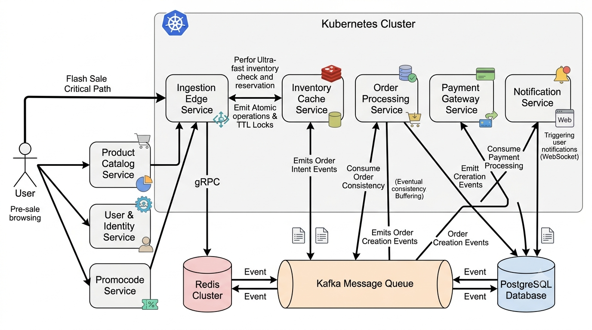

# Architecture Overview: Distributed Flash-Sale Engine

This document defines the comprehensive architecture, data design, and testing protocols for a High-Throughput Distributed Flash-Sale Engine. This system leverages an asynchronous, event-driven architecture coupled with an 8-service microservices mesh to decouple rapid traffic ingestion from permanent data persistence. It guarantees zero inventory overselling, sub-second response times, and massive horizontal scalability.

## 1. Distributed System Architecture: The 8-Service Topology

The visual topology illustrates how the backend is entirely decoupled into isolated microservices running in a Kubernetes cluster. Critical path ingestion is kept synchronous and highly available. Heavy state mutations are offloaded to asynchronous background workers.

The system relies on the following services:

- **User & Identity Service:** Manages user registration, authentication, JWT signing, and public-key publishing. It signs tokens with asymmetric algorithms such as RS256 or ES256 and exposes the active public keys through JWKS/gRPC for edge-side caching.
- **Product Catalog Service:** Manages items, descriptions, and initial stock states. It broadcasts updates via Kafka.
- **Promo & Coupon Service:** Validates promotional codes, pricing tiers, and eligibility rules during the checkout process.
- **Ingestion Edge Service:** Acts as the ultra-fast entry point for the critical path checkout. It runs rate limits, verifies JWT signatures locally using cached public keys, and initiates the Redis allocation. This service is completely stateless.
- **Inventory Cache Service:** Wraps the Redis cluster. It executes atomic Lua scripts for deductions and idempotency.
- **Order Processing Service:** Consumes Kafka events. It transforms memory reservations into durable SQL ledger entries.
- **Payment Gateway Service:** Manages 3rd-party gateway integrations, webhooks, and payment state machines.
- **Notification Service:** Listens to final order statuses. It triggers WebSockets, SMS, or Emails to the user.

---

## 2. Inter-Service Communication & Data Flow

To ensure this cluster handles 20,000+ requests per second, the communication patterns are strictly divided between the Synchronous Path for speed and the Asynchronous Path for durability.

### The 100ms Ingestion Loop (Synchronous Path)

1.  The client hits the Ingestion Edge Service to claim an item.
2.  The Ingestion Edge verifies the JWT signature locally with a cached public key. Keys are fetched from the User & Identity Service via JWKS or gRPC and refreshed on TTL/key-id misses.
3.  The Ingestion Edge sends a gRPC reservation command to the Inventory Cache Service. The Lua script executes. If stock is available, it returns Success immediately.
4.  The Ingestion Edge drops a message into the Kafka message queue and returns HTTP 202 Accepted. The user's checkout is legally reserved in under 50ms.

### Identity Key Distribution

Per-request token validation must not call the User & Identity Service during a flash-sale spike. The identity service signs access tokens with an asymmetric algorithm, currently RS256, with ES256 supported as a future profile. Public keys are published by key id (`kid`) through `/.well-known/jwks.json` and the internal key service. Ingestion Edge instances cache the key set locally and validate JWT signatures, issuer, audience, and expiry without network I/O on the hot path. A background refresh and a synchronous miss path for unknown `kid` values keep key rotation safe without turning auth into a bottleneck.

### The Background Convergence (Asynchronous Path)

1.  The Order Processing Service pulls micro-batches of intent events from Kafka.
2.  Items are written directly to PostgreSQL. Once committed, an order creation event is fired into Kafka.
3.  The Payment Gateway and Notification Services consume the order creation event. This finalizes the invoice and sends a WebSocket alert to the client browser.

---

## 3. Infrastructure, Autoscaling & Resiliency Patterns

- **Token Bucket Rate Limiting:** Each client IP maps to an active token bucket in Redis. Capacity is 10 tokens, refilled at 10/sec. If the bucket zeroes out, the Ingestion Edge Service rejects the request before it touches any core logic.
- **Kubernetes Autoscaling:** CPU-based Horizontal Pod Autoscaler (HPA) targets 70% utilization for the Ingestion and Cache layers. Policies allow 200% scale-up within 10 seconds to absorb spikes. The Order Worker Layer is scaled via KEDA targeting Kafka Consumer Lag.
- **Circuit Breakers & Dead Letter Queues (DLQ):** If the PostgreSQL instance drops connections, the Order Processing workers will trip their internal Circuit Breaker after 5 consecutive failures. Kafka consumption pauses to buffer the data safely. Corrupt singular payloads are shunted to a Dead Letter Queue topic to prevent head-of-line blocking.

---

## 4. Schema & Data Storage Layout

- **Redis Key Architecture:** Serves as the in-memory isolation layer. It utilizes a Core Inventory Tracker key mapping string to integer, an Idempotency Lock Layer with a 5-minute TTL, and a Double-Purchase Prevention Guard.
- **PostgreSQL Core Ledger:** Acts as the relational truth. It contains a `products` table tracking initial stock and an `orders` table storing a UUID, the idempotency key, and status.
